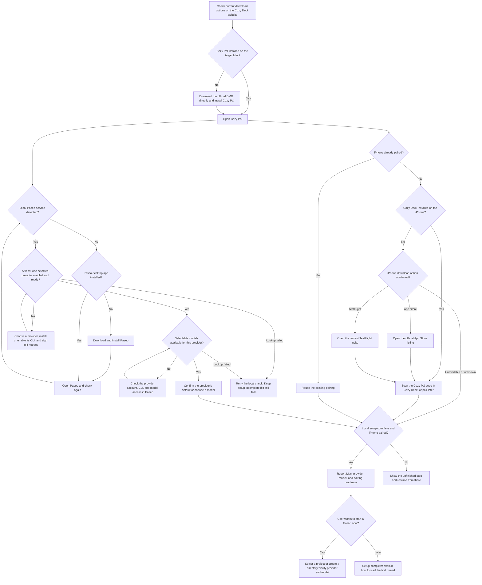

# Set up Cozy Pal

Run local checks on the Mac that will run the user's coding agents. A cloud terminal, a different computer, or an SSH session to another host cannot prove local installation. If you lack access to the target Mac, give the user the next concrete action and ask what they see. Use their language. Keep guidance focused on setup actions, blockers, and verified results.

## What the apps do

- **Cozy Deck** is the iPhone app. It connects to the Mac so the user can see coding sessions, send replies, and handle supported approvals away from the desk.
- **Cozy Pal** is the Mac menu bar app. It pairs the phone with the Mac and connects Cozy Deck to tools running on that Mac.
- **Paseo** is the coding-agent runtime used in this guide. Paseo on the Mac exposes project folders and runs the configured providers and models. Pairing the iPhone connects it to the Mac. Project registration and provider readiness are checked in Paseo.

If the user reports a problem, start with [Troubleshoot Cozy Deck and Cozy Pal](references/troubleshooting.md). Resume onboarding at the first unfinished step after diagnosis.

## Onboarding flow

Start at the first unfinished step. Tool setup and iPhone pairing can proceed in either order.

## Check current download options

Read the [official Cozy Deck product page](https://sundaydesk.app/cozy-deck/) at the start of onboarding. Check the links and their surrounding labels, including the setup section, using available tools. If the page cannot be read, continue with the official DMG fallback below and leave unverified download options pending. Check the two apps separately.

- **Cozy Deck for iPhone.** If the website links to the public Cozy Deck listing on `apps.apple.com`, confirm the Apple page is for Cozy Deck and give the user that link to open on their iPhone. When the website offers both App Store and TestFlight, use the App Store for normal setup and TestFlight when the user wants the beta. If the website offers TestFlight, read the current `testflight.apple.com/join/…` link directly from the website, confirm the Apple invite is for Cozy Deck, then share it and explain how to join and install with TestFlight. If Apple says the beta is full, closed, or unavailable, report that state and use a verified App Store link if one exists.
- **Cozy Pal for Mac.** Read the current DMG link, version if shown, and supported macOS from the product page or its [Cozy Pal setup guide](https://sundaydesk.app/products/cozy-deck/setup/). Use the current official DMG URL directly when installation is needed. Cozy Pal's availability is independent of the iPhone release channel.
- If you cannot verify an iPhone download option, share the official product page and mark the iPhone install as pending. Continue with Mac setup. Take Apple links from the current website and avoid inferring a URL from a cached invite code, an App Store search result, or a release announcement alone.

## 1. Check and install Cozy Pal

- Check the target Mac against the system requirements on the official website before installing. If the requirements cannot be verified, the bundled DMG below is for Apple silicon and macOS 14 or later.
- Look for Cozy Pal in Applications, including the user's Applications folder. Reuse an existing working installation and its pairing identity. If it is absent, download the current official DMG directly. If the official website cannot be read, the [bundled Cozy Pal 1.0.4 DMG link](https://sundaydesk.app/downloads/cozy-pal/CozyPal-1.0.4.dmg) is a fallback. Confirm that it still serves the DMG and verify the app before running it. Mount the DMG with Finder, copy **Cozy Pal.app** to Applications, eject the image, and open the installed app. If acting with terminal tools, verify the downloaded app with the system's code-signing and Gatekeeper checks before running it. Hand macOS security prompts to the user. If the download is unavailable or verification fails, report the failure and the official source instead of substituting a mirror.
- Open First-Time Setup from Cozy Pal if needed. Earlier releases offer Pairing instead. Verify that the installed app opens.

## 2. Detect or install Paseo

- Check both the installed desktop app and whether Cozy Pal detects the local Paseo service. An installed app may be closed, and an absent `paseo` shell command does not imply desktop Paseo is missing.
- Open an existing Paseo installation or use the [official Paseo download](https://paseo.sh/download). The desktop app starts its own daemon. Follow the [Paseo getting-started guide](https://paseo.sh/docs). Avoid starting a second daemon for a working desktop installation.
- Return to Cozy Pal and confirm Paseo is detected. If necessary, use its tool detection action. If detection still fails, check that Paseo has opened its local host and that both apps are on the same Mac.

## 3. Make one provider usable

- Reuse the user's preferred installed coding tool. If they have not chosen one, ask which existing account or provider they want to use. Paseo's built-in adapters still require the underlying agent CLI and its authentication. Follow [supported providers](https://paseo.sh/docs/supported-providers) and the selected vendor's installation and login guidance. If the account needs login, let the user complete it in the vendor's UI or CLI. Keep passwords, API keys, and tokens out of the prompt, transcript, and logs.
- Use the selected provider's Diagnostic in Paseo's local host settings. If the matching CLI is available, use the installed version's help and the documented `paseo provider diagnostic <provider-id>` command against the same local daemon. Confirm Paseo itself sees the provider and its models. If the tool works in the terminal but not in Paseo, use the daemon's diagnostic to check its command and environment.
- When Paseo is running but no provider is ready, go to Settings → local host → Providers. Help the user choose one provider and fix the specific issue reported by Diagnostic, then check again. A failed lookup leaves readiness unconfirmed.
- Keep working provider settings. Use [custom provider configuration](https://paseo.sh/docs/custom-providers) only when the user needs a custom endpoint, model, or executable. Apply the smallest change to the chosen provider.

## 4. Choose or create a project when needed

- Cozy Deck and Cozy Pal support creating directories. Explain how to select an existing project or create a directory in the app on the intended Mac. Let the user choose when to do this; project registration and an absolute path are not prerequisites for completing Mac setup or pairing.
- If the user wants help with a project now, use the app's project selection or directory creation flow. Confirm the intended host and the user's chosen location and name before creating a directory. Preserve existing directories and check the result before retrying an unclear creation outcome.
- Verify the selected or newly created directory appears as a usable project on that host. In **New thread**, check that the chosen provider offers selectable models and confirm the default or the user's choice. If the user defers project selection, report Mac/provider readiness separately and leave this check for their first thread.
- Use Paseo project registration only as a fallback for a missing project or when explicitly requested. Check existing projects first, reuse a matching folder, and follow the installed CLI's help and [Paseo CLI reference](https://paseo.sh/docs/cli). Ask for an exact path only when the chosen fallback needs one. Confirm the CLI targets the same local daemon Cozy Pal detected.

## 5. Pair the iPhone and verify access

1. If the iPhone is already paired with this Mac, reuse that pairing. If Cozy Deck is missing on the iPhone, give the user the verified App Store listing or TestFlight invite from the official website.
2. On the Mac where the coding tools run, open **Cozy Pal** from the menu bar. Go to **Pairing**, or use the pairing step in **First-Time Setup** when present. Keep the Mac awake. Use the live QR shown in Pal. Refresh it if it expires or was already used.
3. On iPhone, open **Cozy Deck → Add Host** and scan the live QR. Wait for pairing to complete. Verify the intended Mac appears on the phone and the phone appears in Cozy Pal's **Devices**. If the scan or connection fails, use the [pairing troubleshooting steps](references/troubleshooting.md#pairing-fails-or-times-out).
4. With the host reachable, explain how to open **New thread**, select an existing project or create a directory, and choose the provider and model. If the user does this now, verify the resulting project, provider, and model are available. If the project list is empty or fails to load, use the [project troubleshooting steps](references/troubleshooting.md#paired-but-cant-see-or-add-a-project). Keep Cozy Pal and Paseo running on the Mac for continued access.

The user can pair before tool setup is complete or come back to pairing later. Keep the live QR and any pairing material on the user's devices. If interrupted, report the last verified step and where to resume. See the [official pairing guide](https://sundaydesk.app/products/cozy-deck/#pairing).
