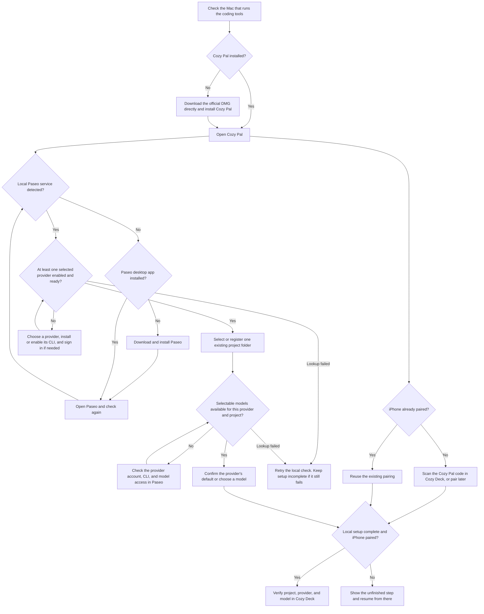

# Set up Cozy Pal

Run local checks on the Mac that will run the user's coding agents. A cloud terminal, a different computer, or an SSH session to another host cannot prove local installation. If you lack access to the target Mac, give the user the next concrete action and ask what they see. Use their language.

## Onboarding flow

Start at the first unfinished step. Tool setup and iPhone pairing can proceed in either order.

## 1. Check and install Cozy Pal

- Check macOS version and hardware. Sunday Desk currently lists Apple silicon and macOS 14 or later. Recheck [the official Cozy Deck product page](https://sundaydesk.app/cozy-deck/#pair) if the installed build or supported platform differs.
- Look for Cozy Pal in Applications, including the user's Applications folder. Reuse an existing working installation and its pairing identity. If it is absent, download the [official Cozy Pal DMG](https://sundaydesk.app/downloads/cozy-pal/CozyPal-1.0.0.dmg) directly. If the versioned URL is unavailable, use the manual download link from the [Cozy Pal setup guide](https://sundaydesk.app/products/cozy-deck/setup/) or the current link on the official product page. Mount the DMG with Finder, copy **Cozy Pal.app** to Applications, eject the image, and open the installed app. If acting with terminal tools, verify the downloaded app with the system's code-signing and Gatekeeper checks before running it. Hand macOS security prompts to the user. If the download is unavailable or verification fails, report the failure and the official source instead of substituting a mirror.
- Open First-Time Setup from Cozy Pal if needed. Earlier releases offer Pairing instead. Verify that the installed app opens.

## 2. Detect or install Paseo

- Check both the installed desktop app and whether Cozy Pal detects the local Paseo service. An installed app may be closed, and an absent `paseo` shell command does not imply desktop Paseo is missing.
- Open an existing Paseo installation or use the [official Paseo download](https://paseo.sh/download). The desktop app starts its own daemon. Follow the [Paseo getting-started guide](https://paseo.sh/docs). Avoid starting a second daemon for a working desktop installation.
- Return to Cozy Pal and confirm Paseo is detected. If necessary, use its tool detection action. If detection still fails, check that Paseo has opened its local host and that both apps are on the same Mac.

## 3. Make one provider usable

- Reuse the user's preferred installed coding tool. If they have not chosen one, ask which existing account or provider they want to use. Paseo's built-in adapters still require the underlying agent CLI and its authentication. Follow [supported providers](https://paseo.sh/docs/supported-providers) and the selected vendor's installation and login guidance. If the account needs login, let the user complete it in the vendor's UI or CLI. Keep passwords, API keys, and tokens out of the prompt, transcript, and logs.
- Use the selected provider's Diagnostic in Paseo's local host settings. If the matching CLI is available, use the installed version's help and the documented `paseo provider diagnostic <provider-id>` command against the same local daemon. Confirm Paseo itself sees the provider and its models. If the tool works in the terminal but not in Paseo, use the daemon's diagnostic to check its command and environment.
- When Paseo is running but no provider is ready, go to Settings → local host → Providers. Help the user choose one provider and fix the specific issue reported by Diagnostic, then check again. A failed lookup leaves readiness unconfirmed.
- Keep working provider settings. Use [custom provider configuration](https://paseo.sh/docs/custom-providers) only when the user needs a custom endpoint, model, or executable. Apply the smallest change to the chosen provider.

## 4. Register one existing project

- Ask for the exact local project folder if the user has not identified one. Resolve the directory on the Mac running Paseo. Do not pick a repository solely from the current terminal directory or enroll every folder.
- Check Paseo's existing projects first and reuse the matching folder. Add the folder in Paseo on the local host or, if the installed CLI supports the documented syntax, use `paseo project create "<absolute-project-path>"` followed by `paseo project ls`. Verify the CLI targets the same local daemon Cozy Pal detected. The [Paseo CLI reference](https://paseo.sh/docs/cli) and [workspace guide](https://paseo.sh/docs/workspaces) cover version-specific commands and the distinction between projects and workspaces.
- Verify the project appears on that host. In the project's new-session setup, check that the provider offers at least one selectable model. Confirm the default if one is offered, or ask the user to choose a model. If the list is empty, return to provider diagnostics and check model access. A test run in the repository is optional and should be scoped to what the user requested.

## 5. Hand off to iPhone

If the iPhone is already paired, reuse the pairing. Otherwise guide the user to open Cozy Deck, choose Add Host, and scan the code in **Cozy Pal**. The user can pair before tool setup is complete or come back to pairing later. Keep the live code on the Mac. If the phone is available, verify the selected project, provider, and model in Cozy Deck's new-session flow. Confirm that pairing, provider readiness, and project visibility each have their own evidence. If interrupted, relay the remaining action and resume from the observed state.
